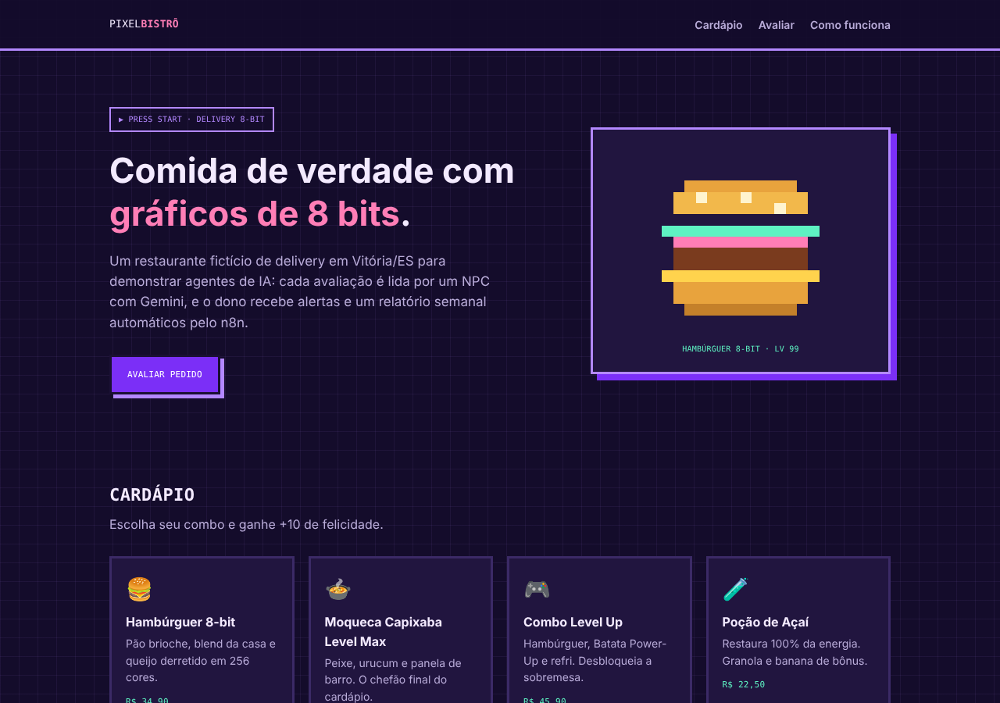
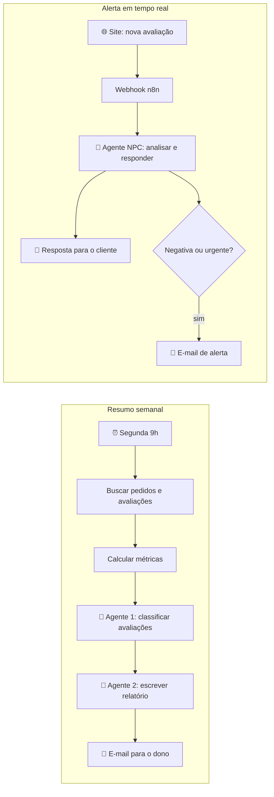
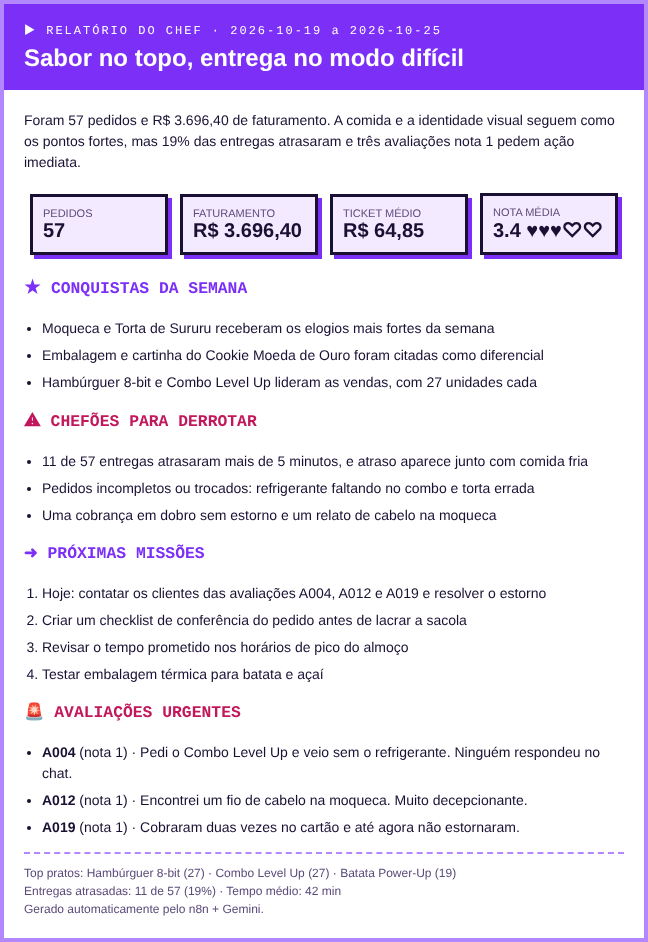

<h1 align="center">🍔 Pixel Bistrô · Agentes de IA para delivery</h1>
<p align="center"><b>n8n + Gemini que leem pedidos e avaliações de um restaurante e transformam tudo em resumo, alerta e resposta ao cliente.</b></p>

<p align="center">
  
  
  
  
</p>

<p align="center">🎮 <a href="https://pixel-bistro-site.vercel.app"><b>Testar o site ao vivo</b></a></p>

<p align="center"></p>

## 🎯 O problema

Um restaurante de delivery recebe dezenas de pedidos e avaliações por semana. O dono não tem tempo de ler tudo, e reclamações graves (pedido errado, cobrança em dobro, problema de higiene) se perdem no meio das outras. Quando ele percebe, o cliente já foi embora.

## 💡 A solução

O **Pixel Bistrô** é um restaurante fictício com tema de videogame que usei para construir dois fluxos de automação com agentes de IA:

| Fluxo | Quando roda | O que faz |
|---|---|---|
| **01 · Resumo semanal** | Toda segunda às 9h | Busca os pedidos e as avaliações da semana, calcula métricas (faturamento, ticket médio, atrasos, pratos mais vendidos, nota média) e usa **dois agentes em sequência**: o primeiro classifica cada avaliação (sentimento, temas, urgência) e o segundo escreve um relatório com destaques, problemas e ações. Envia tudo por e-mail. |
| **02 · Alerta em tempo real** | A cada avaliação nova no site | O **agente NPC** analisa a avaliação, escreve uma resposta que o cliente vê na hora e, se a avaliação for negativa ou urgente, manda um alerta por e-mail para o dono com uma ação sugerida. |



## 🧠 Decisões de projeto

- **Saída estruturada:** os agentes respondem em JSON com um schema fixo (`responseSchema` do Gemini). Isso garante que o n8n sempre consiga ler a resposta, sem depender de "a IA escrever certinho".
- **Dois agentes em vez de um:** um agente só classifica e outro só escreve. Cada um tem uma tarefa simples, e o relatório é escrito em cima de dados já organizados.
- **Métricas calculadas em código, não pela IA:** números como faturamento e ticket médio vêm de JavaScript, que não erra conta. A IA fica com o que ela faz bem: entender texto e escrever.
- **Regra de urgência clara:** higiene, cobrança indevida, pedido errado, item faltando ou nota 1 sempre geram alerta.
- **Custo zero:** Gemini no plano gratuito, n8n e site estático na Vercel.

## 🗂️ Estrutura

```
data/        pedidos, avaliações e cardápio de exemplo (fictícios)
n8n/         os dois fluxos para importar no n8n
n8n/codigo/  o JavaScript de cada nó "Code", separado para leitura
site/        site do restaurante com o formulário de avaliação
docs/        imagens
```

## 🚀 Como rodar

### 1. Chave do Gemini (grátis)
Crie uma chave em [Google AI Studio](https://aistudio.google.com/apikey).

### 2. n8n
Use o [n8n Cloud](https://n8n.io) (tem período de teste) ou rode localmente com `npx n8n`.

1. **Importe os fluxos:** em *Workflows → Import from File*, importe `n8n/01-resumo-semanal.json` e `n8n/02-alerta-avaliacao.json`.
2. **Credencial do Gemini:** crie uma credencial do tipo **Header Auth** chamada `Gemini API Key`, com **Name** `x-goog-api-key` e **Value** igual à sua chave.
3. **Credencial do Gmail:** crie uma credencial **Gmail OAuth2** e entre com a sua conta Google.
4. **Config:** em cada fluxo, abra o nó **Config** e coloque o seu e-mail em `emailDestino`.
5. **Credenciais nos nós:** abra os nós do Gemini e do Gmail e selecione as credenciais que você criou.
6. **Teste o resumo semanal:** no fluxo 01, clique em **Test workflow**. O e-mail chega em alguns segundos.
7. **Ative o alerta:** no fluxo 02, clique em **Active** e copie a **Production URL** do nó Webhook.

### 3. Site
1. Cole a URL do webhook em `site/config.js`.
2. Publique na Vercel: importe o repositório e defina **Root Directory** como `site`.
3. Abra o site, envie uma avaliação com nota baixa e veja o NPC responder e o alerta chegar no seu e-mail.

> Para trocar o modelo, mude `modeloGemini` no nó Config. O padrão é `gemini-3.1-flash-lite`, que está no plano gratuito e responde rápido.

## 📸 Prévia do e-mail semanal



*Layout gerado com os dados de exemplo; o texto do relatório aqui é ilustrativo.*

## 🛣️ Próximos passos

- Ler pedidos e avaliações de uma planilha ou do Supabase em vez de arquivos JSON
- Painel com a evolução da nota média e dos temas semana a semana
- Responder automaticamente no WhatsApp

---

<p align="center">Feito por <a href="https://portfolio-eta-one-ae9ei5wnug.vercel.app/">Lavínea Subtil</a> · Os dados e o restaurante são fictícios.</p>
